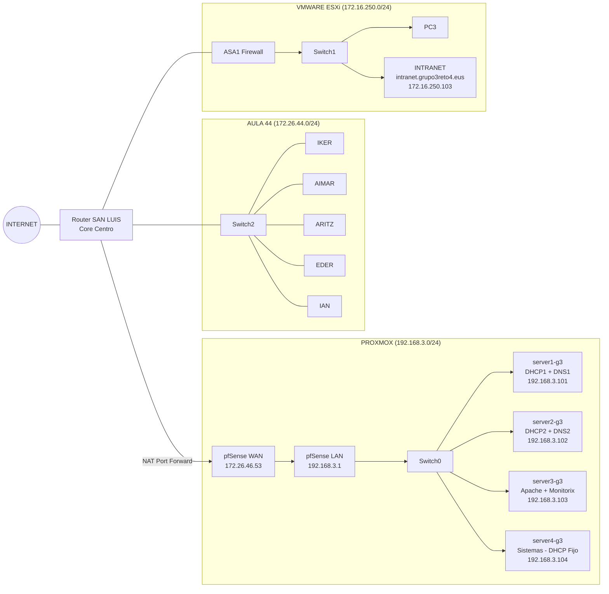

# Reto4-g3

Todos los servidores están montados en Proxmox.

Documentación del proyecto de redes del grupo 3.

## Objetivo

Documentar el diseño, la configuración y las comprobaciones realizadas sobre la infraestructura de red.

## Estructura del repositorio

- [`informe/`](./informe): informe técnico, desarrollo y capturas.
- [`config/`](./config): configuraciones de DHCP, DNS, Netplan/Cloud-Init, Apache y Monitorix.
- [`scripts/`](./scripts): scripts de enrutamiento y comprobación.
- [`diagramas/`](./diagramas): mapa lógico de la red.
- [`gestion.md`](./gestion.md): reparto de tareas.

## Inventario de equipos y direcciones

La infraestructura está segmentada mediante pfSense. La red interna de servidores es
`192.168.3.0/24`, la red del aula es `172.26.44.0/24` y la red de la intranet es
`172.16.250.0/24`.

| Equipo / Servicio | Rol | Dirección IP | Sistema / Software |
|---|---|---|---|
| **pfSense (WAN / LAN)** | Firewall, NAT y Enrutamiento | `172.26.46.53` (WAN) / `192.168.3.1` (LAN) | pfSense CE |
| **Server 1 (`server1-g3`)** | Servidor DNS Maestro | `192.168.3.101/24` | Ubuntu Server + BIND9 |
| **Server 2 (`server2-g3`)** | Servidor DNS Esclavo | `192.168.3.102/24` | Ubuntu Server + BIND9 |
| **Server 3 (`server3-g3`)** | Servidor Web Principal (`www`) y Monitorix | `192.168.3.103/24` | Ubuntu Server + Apache2 |
| **Server 4 (`server4-g3`)** | Servidor DHCP | `192.168.3.104/24` | Ubuntu Server + ISC DHCP |
| **Servidor Intranet** | Servidor Web Intranet (`intranet`) | `172.16.250.103/24` | Ubuntu Server + Apache2 |

Los servidores internos usan como puerta de enlace `192.168.3.1` y como DNS
`192.168.3.101` y `192.168.3.102`. El servidor DHCP ofrece direcciones
`192.168.3.150`–`192.168.3.200`, con dominio `grupo3reto4.eus`.

## Diagrama lógico

## Servicios y accesos publicados

pfSense redirige los siguientes puertos de la WAN hacia los servicios internos:

| Servicio | Puerto WAN | Destino |
|---|---:|---|
| SSH `server1-g3` | `2231` | `192.168.3.101:22` |
| SSH `server2-g3` | `2232` | `192.168.3.102:22` |
| SSH `server3-g3` | `2233` | `192.168.3.103:22` |
| SSH `server4-g3` | `2234` | `192.168.3.104:22` |
| HTTP | `3880` | `192.168.3.103:80` |
| Monitorix | `8381` | `192.168.3.103:8080` |
| DNS TCP/UDP | `53` | `192.168.3.101:53` |
| HTTPS | `443` | `192.168.3.103:443` |