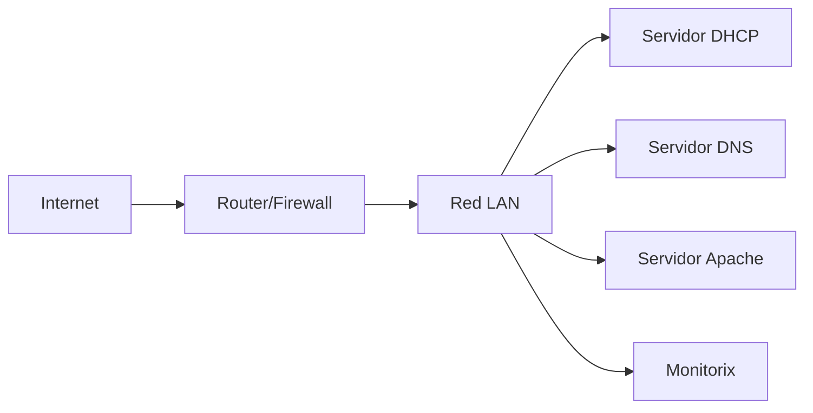

# Reto4-g3

Documentación del proyecto de redes del grupo 3.

## Objetivo

Documentar el diseño, la configuración y las comprobaciones realizadas sobre la infraestructura de red.

## Estructura del repositorio

- [`informe/`](./informe): informe técnico, desarrollo y capturas.
- [`config/`](./config): configuraciones de DHCP, DNS, Netplan/Cloud-Init, Apache y Monitorix.
- [`scripts/`](./scripts): scripts de enrutamiento y comprobación.
- [`diagramas/`](./diagramas): mapa lógico de la red.
- [`gestion.md`](./gestion.md): reparto de tareas.

## Inventario de equipos y direcciones

> Completar estos datos con los valores reales del proyecto. Las entradas sin asignar no deben publicarse con contraseñas, claves privadas ni datos personales.

| Equipo/servicio | Interfaz | Red | Dirección IP | Puerta de enlace | DNS |
|---|---|---|---|---|---|
| Pendiente | Pendiente | Pendiente | Pendiente | Pendiente | Pendiente |

## Diagrama lógico

El diagrama editable y sus instrucciones están en [`diagramas/red.md`](./diagramas/red.md).

