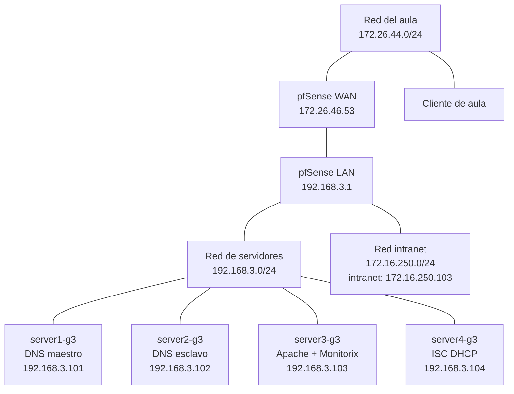

# Mapa lógico de la red

La infraestructura se ejecuta en Proxmox y está segmentada mediante pfSense. La
interfaz WAN de pfSense pertenece a la red del aula y la interfaz LAN conecta
con la red interna de servidores.

## Direccionamiento y servicios

- La puerta de enlace de los servidores es `192.168.3.1`.
- Los servidores DNS son `192.168.3.101` y `192.168.3.102`.
- DHCP entrega direcciones `192.168.3.150`–`192.168.3.200`.
- pfSense publica HTTP (`3880`), HTTPS (`443`), DNS (`53`), Monitorix
  (`8381`) y SSH mediante los puertos `2231`–`2234`.

## Configuración relacionada

- [`config/dhcpd.conf`](../config/dhcpd.conf): servicio DHCP de `server4-g3`.
- [`config/`](../config): configuraciones de DNS, Netplan/Cloud-Init, Apache y
  Monitorix.
- [`scripts/enrutamiento.sh`](../scripts/enrutamiento.sh): reglas de
  enrutamiento.
- [`scripts/comprobacion.sh`](../scripts/comprobacion.sh): comprobaciones de
  conectividad y servicios.
