# Documentación Técnica: Servicios de red e Internet (Grupo 3 - Reto 4)

Todos los servidores están montados en Proxmox. Para ello hemos entrado desde la web para configurar la red de los servidores.

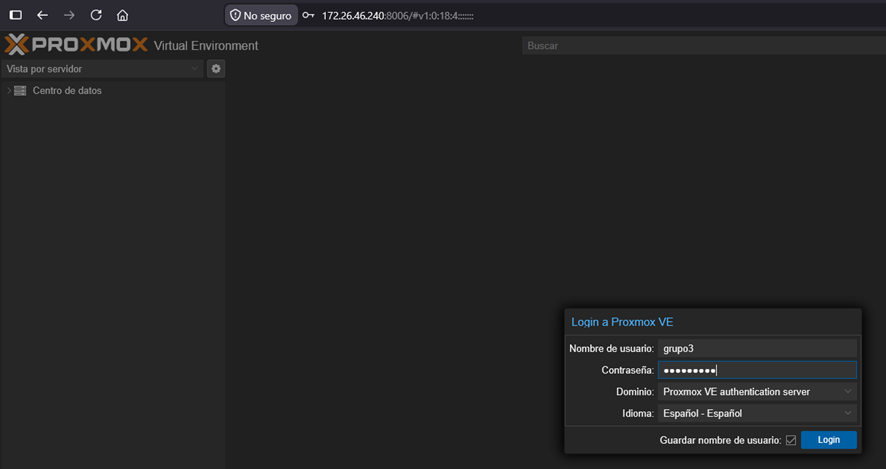

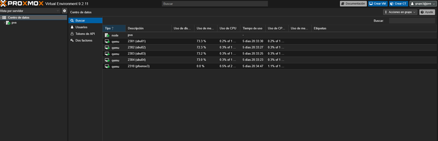

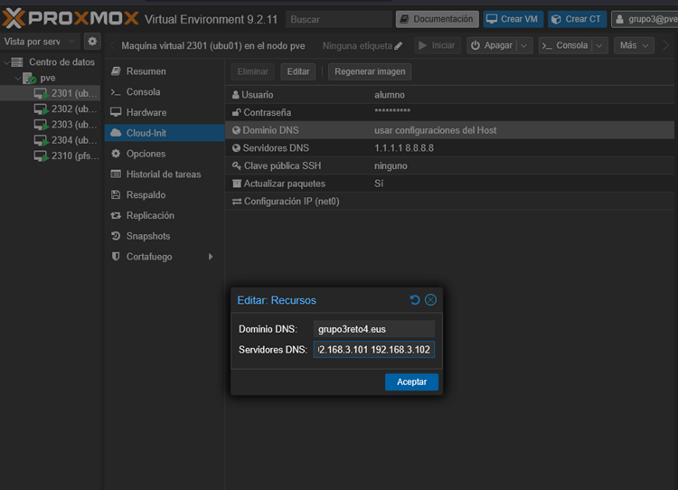

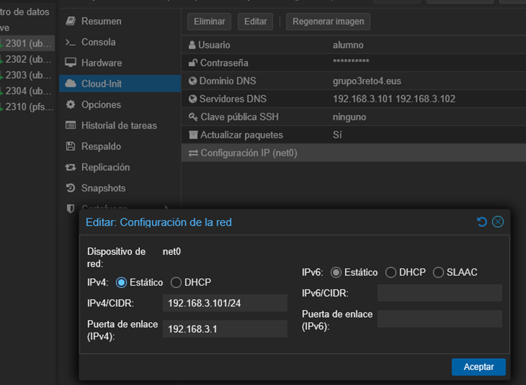

Despues reiniciar las maquinas para que se apliquen los cambios y cambiar el nombre de los servidores.

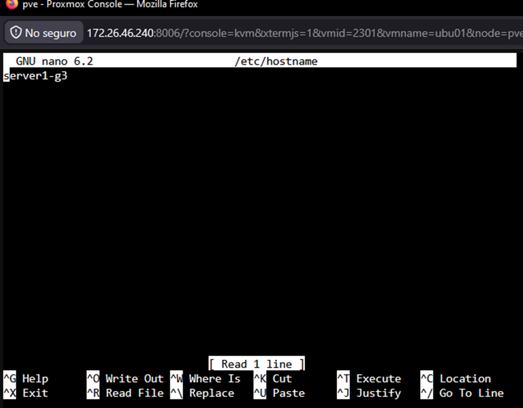

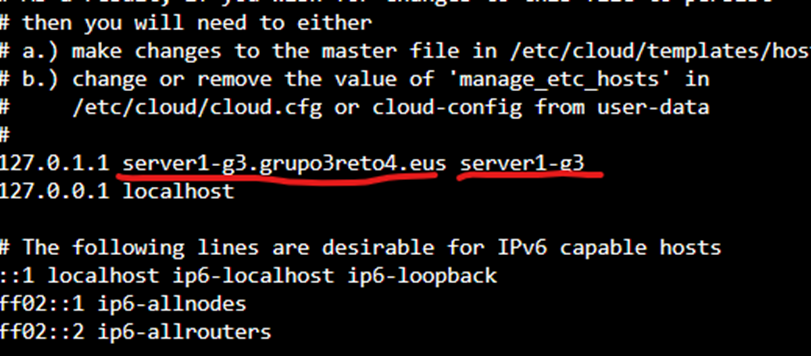

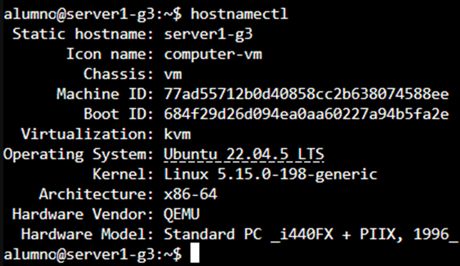

## 1. Arquitectura de Red y Direccionamiento IP

La infraestructura está desplegada detrás de un cortafuegos **pfSense** que segmenta la red interna de servidores (`192.168.3.0/24`) respecto a la red del aula (`172.26.44.0/24`) y enruta el tráfico hacia la red de la intranet (`172.16.250.0/24`).

| Equipo / Servicio | Rol | Dirección IP | Sistema / Software |
| :--- | :--- | :--- | :--- |
| **pfSense (WAN / LAN)** | Firewall, NAT y Enrutamiento | `172.26.46.53` (WAN) / `192.168.3.1` (LAN) | pfSense CE |
| **Server 1 (`server1-g3`)** | Servidor DNS Maestro | `192.168.3.101/24` | Ubuntu Server + BIND9 |
| **Server 2 (`server2-g3`)** | Servidor DNS Esclavo | `192.168.3.102/24` | Ubuntu Server + BIND9 |
| **Server 3 (`server3-g3`)** | Servidor Web Principal (`www`) y Monitorix | `192.168.3.103/24` | Ubuntu Server + Apache2 |
| **Server 4 (`server4-g3`)** | Servidor DHCP | `192.168.3.104/24` | Ubuntu Server + ISC DHCP |
| **Servidor Intranet** | Servidor Web Intranet (`intranet`) | `172.16.250.103/24` | Ubuntu Server + Apache2 |

### 1.1 Configuración de Red Estática (Netplan)

Todos los servidores internos cuentan con direccionamiento IP estático configurado en `/etc/netplan/*.yaml`, utilizando como puerta de enlace `192.168.3.1` y como servidores DNS `192.168.3.101` y `192.168.3.102`:

```yaml
network:
  version: 2
  ethernets:
    ens18:
      dhcp4: false
      addresses:
        - 192.168.3.10X/24
      routes:
        - to: default
          via: 192.168.3.1
      nameservers:
        addresses:
          - 192.168.3.101
          - 192.168.3.102
```

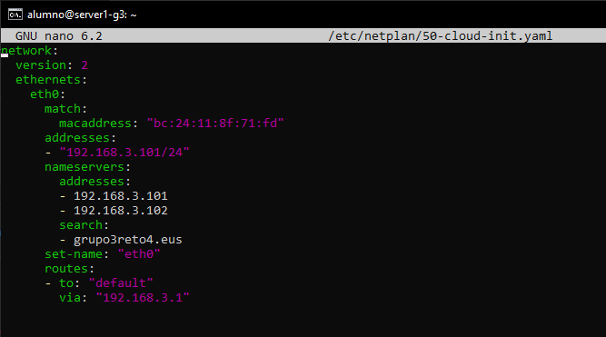

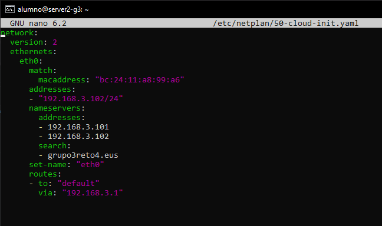

### 1.2 Acceso SSH a las maquinas

1. Crear las claves publicas y privadas de cada usuario que vaya a acceder+

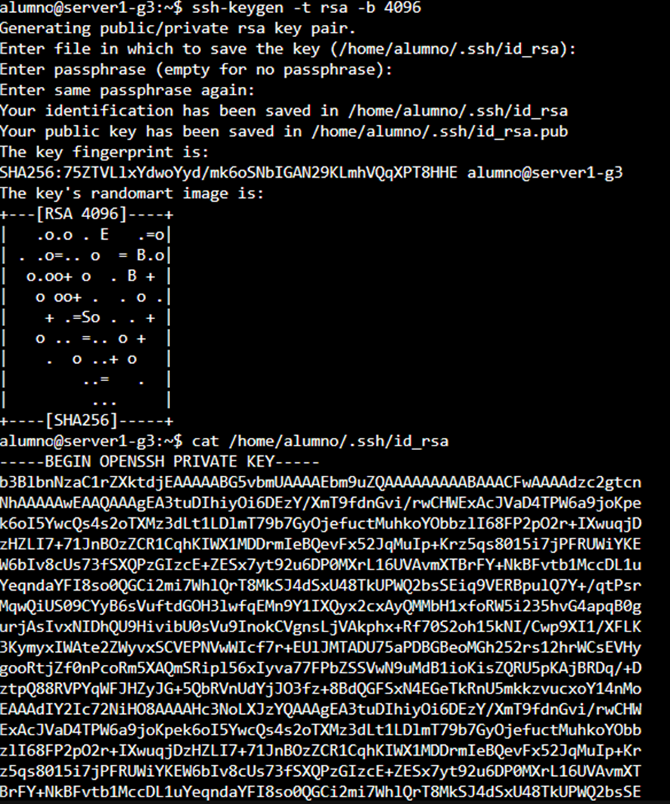

En este caso cambiar el nombre de quien es y añadir en la carpeta .ssh

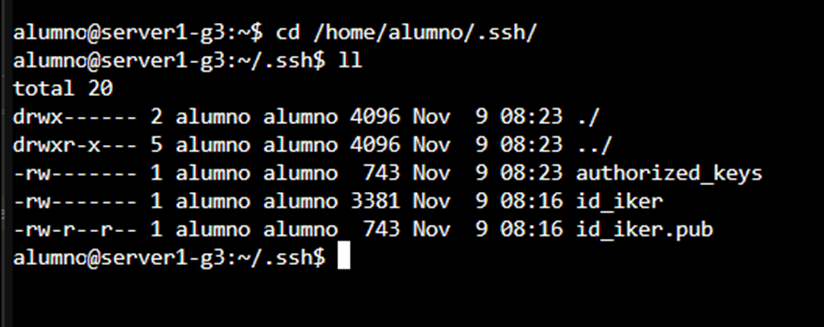

Crear la clave en el host para poder acceder:

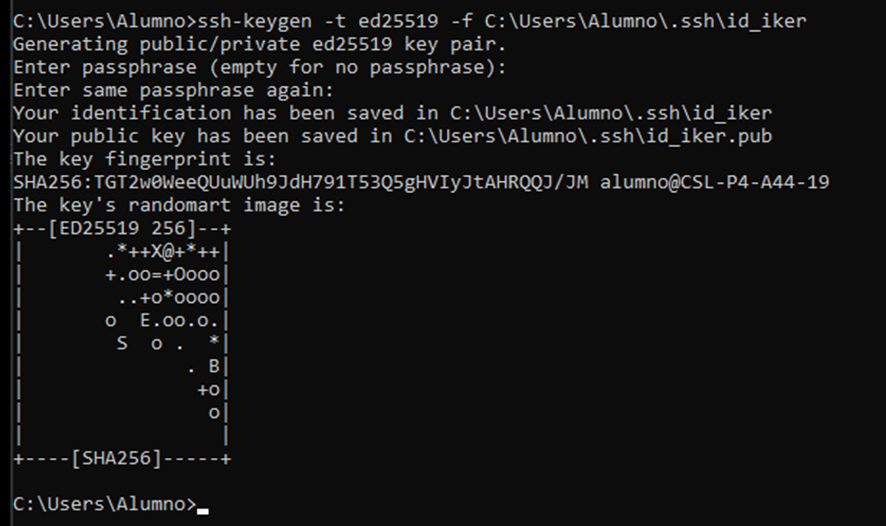

Añadir la clave de Windows en Linux

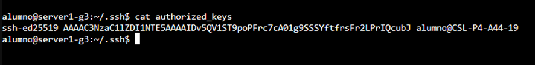

Activar opciones para poder conectarse mediante SSH con la clave de cada usuario

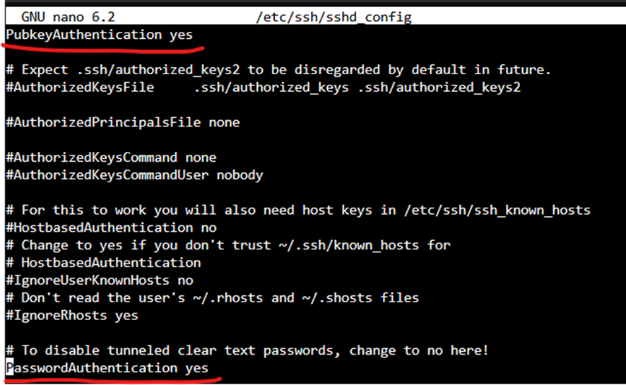

Se configura el archivo .config en el host para acceder de forma mas comoda, solo poniendo un alias del servidor:

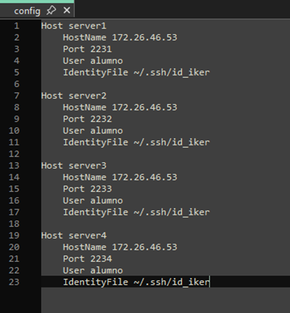

Y añadir las claves y el archivo config en .ssh del host

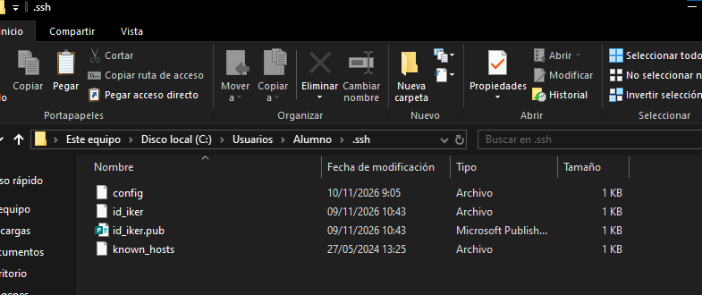

Comprobar si funciona la conexion por SSH al server:

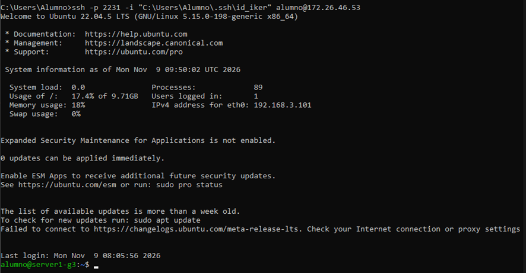

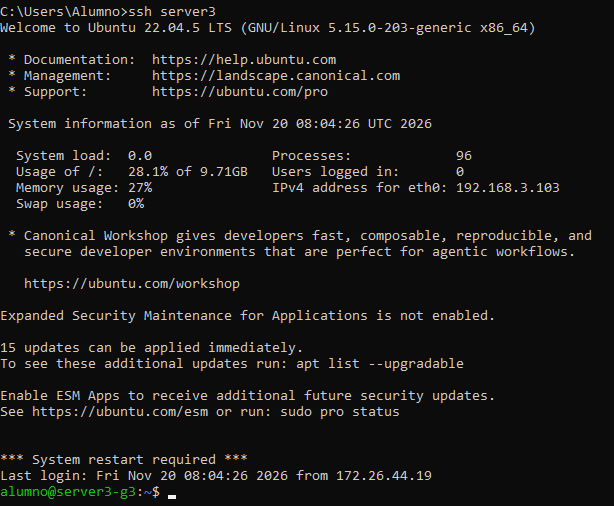

Para que el resto del grupo pueda acceder habra que meter todas las claves

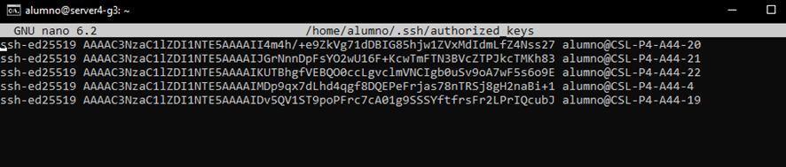

Adjunto de la comprobacion desde el PC 4:

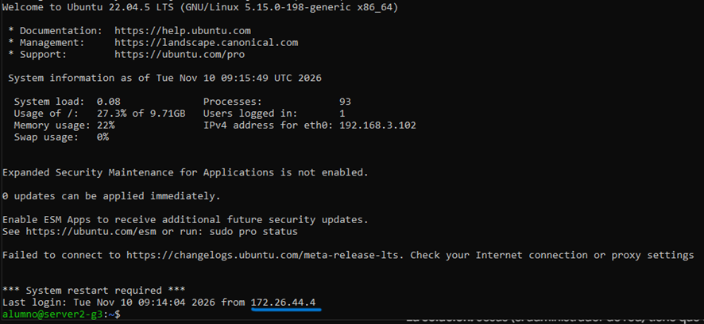

---

## 2. Fase 1: Configuración del Firewall pfSense

1. Cambiar la IP de la red LAN

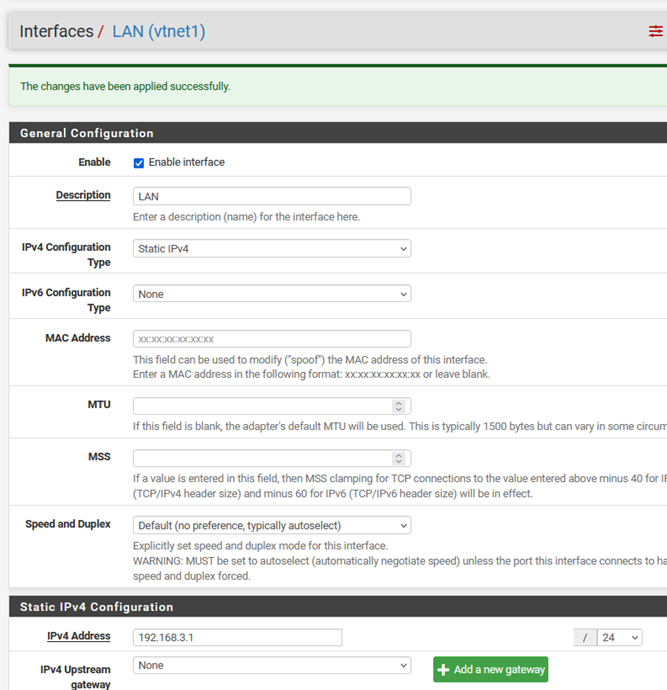

### 2.1 Deshabilitación del Servicio DHCP Local

1. Acceder a **Services > DHCP Server > LAN**.
2. Desmarcar la opción **Enable DHCP server on LAN interface**.
3. Guardar los cambios con **Save** para que toda la red opere exclusivamente mediante direccionamiento estático.

### 2.2 Política Restrictiva en la Interfaz LAN

1. Acceder a **Firewall > Rules > LAN**.
2. Eliminar las reglas predeterminadas de acceso total (`Default allow LAN to any rule`).
3. Sincronizar el servidor NTP

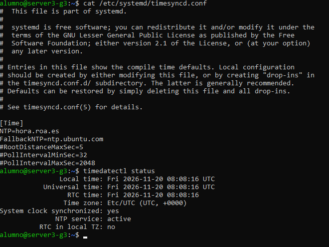


### 2.3 Reenvío de Puertos (Port Forwarding) en WAN

En **Firewall > NAT > Port Forward**, se han configurado las siguientes reglas de redirección hacia la red interna (`192.168.3.0/24`):

| Descripción | Interfaz | Protocolo | Destino (`Dest. Address`) | Puerto Externo (`Dest. Ports`) | IP Destino (`NAT IP`) | Puerto Interno (`NAT Ports`) |
| :--- | :--- | :--- | :--- | :--- | :--- | :--- |
| **server1** (SSH) | WAN | TCP | `WAN address` (`172.26.46.53`) | `2231` | `192.168.3.101` | `22 (SSH)` |
| **server2** (SSH) | WAN | TCP | `WAN address` (`172.26.46.53`) | `2232` | `192.168.3.102` | `22 (SSH)` |
| **server3** (SSH) | WAN | TCP | `WAN address` (`172.26.46.53`) | `2233` | `192.168.3.103` | `22 (SSH)` |
| **server4** (SSH) | WAN | TCP | `WAN address` (`172.26.46.53`) | `2234` | `192.168.3.104` | `22 (SSH)` |
| **apache** (HTTP) | WAN | TCP | `WAN address` (`172.26.46.53`) | `3880` | `192.168.3.103` | `80 (HTTP)` |
| **monitorix** | WAN | TCP | `WAN address` (`172.26.46.53`) | `8381` | `192.168.3.103` | `8080` |
| **dns** | WAN | TCP/UDP | `WAN address` (`172.26.46.53`) | `53 (DNS)` | `192.168.3.101` | `53 (DNS)` |
| **Pagina web https** | WAN | TCP | `WAN address` (`172.26.46.53`) | `443 (HTTPS)` | `192.168.3.103` | `443 (HTTPS)` |

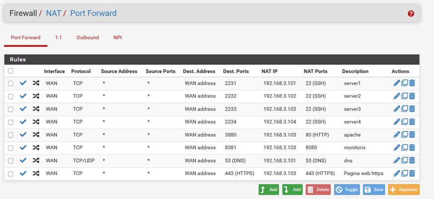

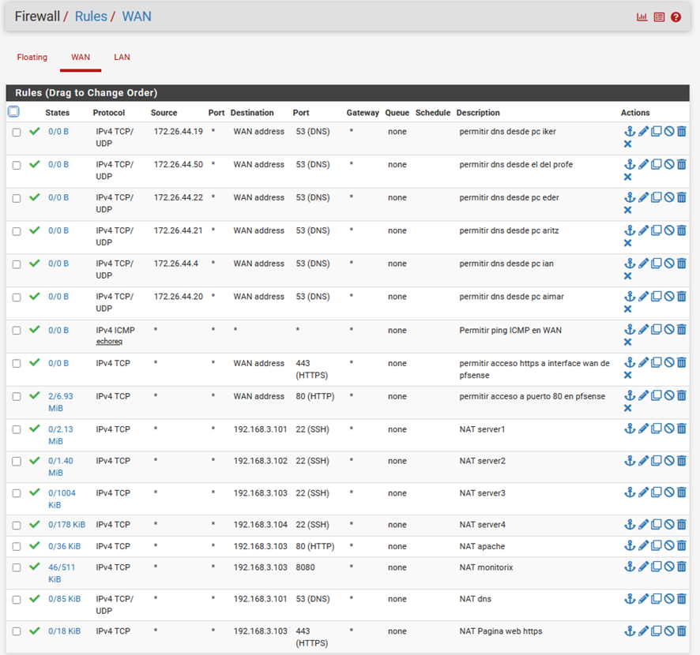

Y configurar en Servicios del firewall, en el DNS resolvs, host overrides, añadir las webs para que las resuelva:

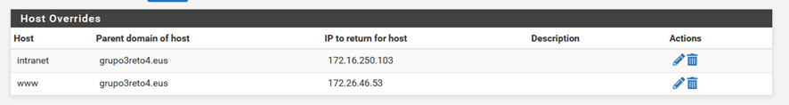

---

## 3. Fase 2: Servicio DNS Redundante Maestro-Esclavo (BIND9)

### 3.1 Configuración del Servidor DNS Maestro (`Server 1` - `192.168.3.101`)

Instalar bind9 en el servidor maestro

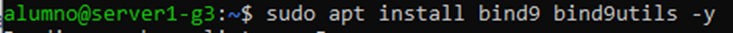

1. **Opciones globales (`/etc/bind/named.conf.options`):**
   Se habilitan las consultas para localhost, la red interna y la red del aula:

   ```text
   options {
       directory "/var/cache/bind";
       allow-query { localhost; 192.168.3.0/24; 172.26.44.0/24; };
       recursion yes;
       forwarders { 8.8.8.8; 1.1.1.1; };
       dnssec-validation auto;
   };
   ```
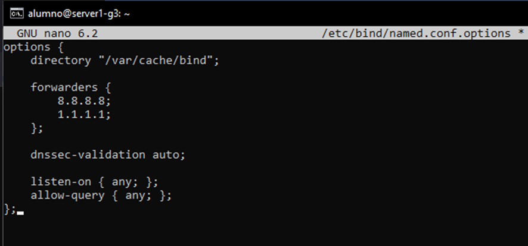

2. **Declaración de zonas (`/etc/bind/named.conf.local`):**

   ```text
   zone "grupo3reto4.eus" {
       type master;
       file "/etc/bind/db.grupo3reto4.eus";
       allow-transfer { 192.168.3.102; };
       also-notify { 192.168.3.102; };
   };

   zone "3.168.192.in-addr.arpa" {
       type master;
       file "/etc/bind/db.192.168.3";
       allow-transfer { 192.168.3.102; };
       also-notify { 192.168.3.102; };
   };
   ```
   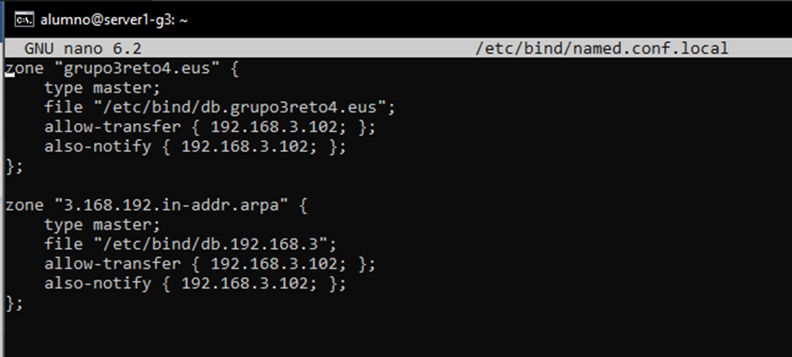


3. **Archivo de zona directa (`/etc/bind/db.grupo3reto4.eus`):**

   ```text
   $TTL    604800
   @       IN      SOA     ns1.grupo3reto4.eus. admin.grupo3reto4.eus. (
                                 2026112001 ; Serial
                                 604800     ; Refresh
                                 86400      ; Retry
                                 2419200    ; Expire
                                 604800 )   ; Negative Cache TTL
   ;
   @       IN      NS      ns1.grupo3reto4.eus.
   @       IN      NS      ns2.grupo3reto4.eus.

   ns1      IN      A       192.168.3.101
   ns2      IN      A       192.168.3.102
   server1  IN      A       192.168.3.101
   server2  IN      A       192.168.3.102
   server3  IN      A       192.168.3.103
   server4  IN      A       192.168.3.104
   @        IN      A       172.26.46.53
   www      IN      A       172.26.46.53
   intranet IN      A       172.16.250.103
   ```
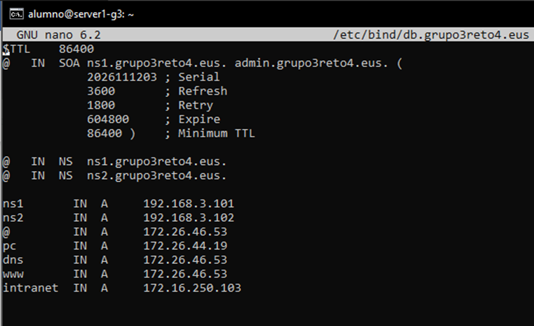

4. **Archivo de zona inversa (`/etc/bind/db.192.168.3`):**

   ```text
   $TTL    604800
   @       IN      SOA     ns1.grupo3reto4.eus. admin.grupo3reto4.eus. (
                                 2026112001 ; Serial
                                 604800     ; Refresh
                                 86400      ; Retry
                                 2419200    ; Expire
                                 604800 )   ; Negative Cache TTL
   ;
   @       IN      NS      ns1.grupo3reto4.eus.
   @       IN      NS      ns2.grupo3reto4.eus.

   101     IN      PTR     server1.grupo3reto4.eus.
   102     IN      PTR     server2.grupo3reto4.eus.
   103     IN      PTR     server3.grupo3reto4.eus.
   104     IN      PTR     server4.grupo3reto4.eus.
   ```
   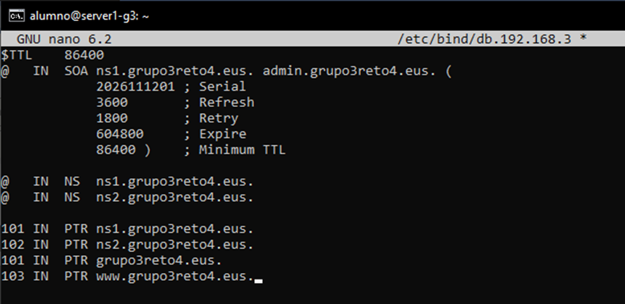

5. **Validación y reinicio del servicio:**

   ```bash
   sudo named-checkconf
   sudo named-checkzone grupo3reto4.eus /etc/bind/db.grupo3reto4.eus
   sudo named-checkzone 3.168.192.in-addr.arpa /etc/bind/db.192.168.3
   sudo systemctl restart bind9
   ```

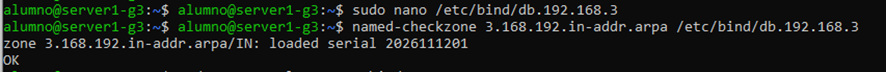

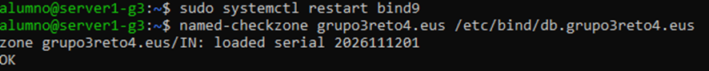

### 3.2 Configuración del Servidor DNS Esclavo (`Server 2` - `192.168.3.102`)

1. Configurar `/etc/bind/named.conf.local` como tipo `slave` apuntando al maestro `192.168.3.101`:

   ```text
   zone "grupo3reto4.eus" {
       type slave;
       file "/var/cache/bind/db.grupo3reto4.eus";
       masters { 192.168.3.101; };
   };

   zone "3.168.192.in-addr.arpa" {
       type slave;
       file "/var/cache/bind/db.192.168.3";
       masters { 192.168.3.101; };
   };
   ```
   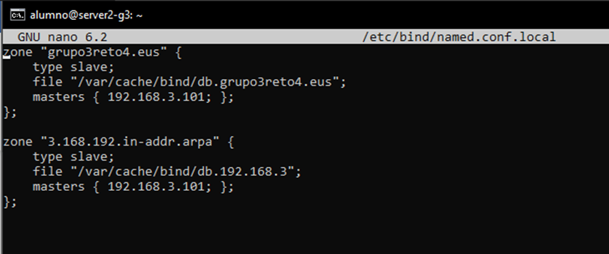

2. Reiniciar BIND9 (`sudo systemctl restart bind9`) y verificar la transferencia automática de zonas en `/var/cache/bind/`.

3. Comprobaciones de que funcionan bien:

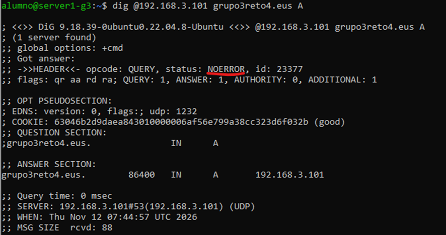

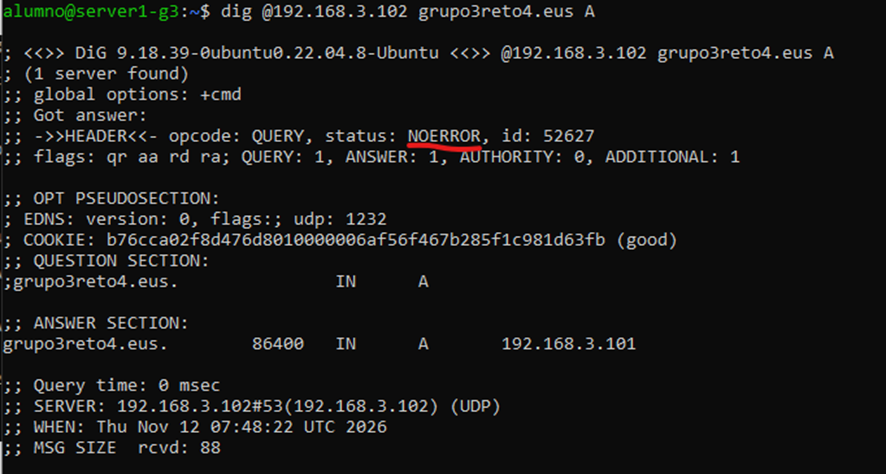

Comprobar la resolucion de nombres:

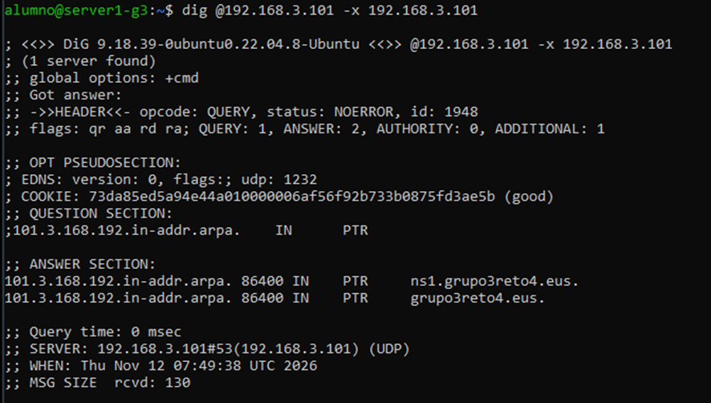

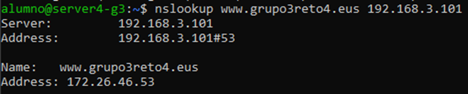

---

## 4. Fase 3: Servicio DHCP (ISC DHCP Server)

### 4.1 Configuración del Servidor DHCP (`Server 4` - `192.168.3.104`)

1. Instalar el servidor DHCP en el servidor asignado:

   ```bash
   sudo apt update
   sudo apt install isc-dhcp-server
   ```

   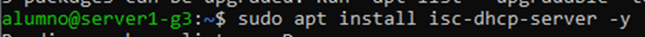

2. Configurar la interfaz donde el servicio escuchará en `/etc/default/isc-dhcp-server`:

   ```text
   INTERFACESv4="eth0"
   INTERFACESv6=""
   ```

   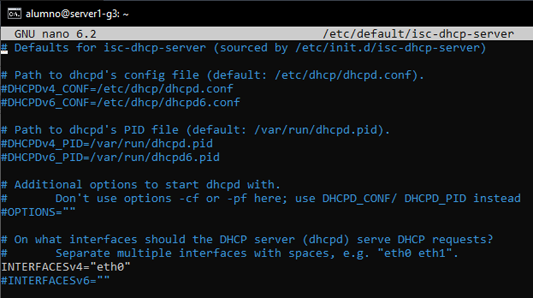

3. Definir la red, el rango dinámico y las opciones de red en `/etc/dhcp/dhcpd.conf`:

   ```text
   default-lease-time 600;
   max-lease-time 7200;

   option domain-name "grupo3reto4.eus";
   option domain-name-servers 192.168.3.101, 192.168.3.102;

   subnet 192.168.3.0 netmask 255.255.255.0 {
       range 192.168.3.150 192.168.3.200;
       option routers 192.168.3.1;
       option broadcast-address 192.168.3.255;
   }
   ```

   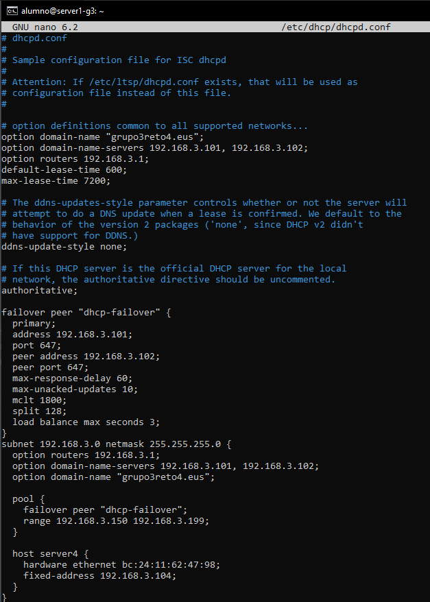

4. Validar la configuración y reiniciar el servicio:

   ```bash
   sudo dhcpd -t -cf /etc/dhcp/dhcpd.conf
   sudo systemctl restart isc-dhcp-server
   sudo systemctl enable isc-dhcp-server
   ```

5. Comprobar el estado del servicio y la concesión de direcciones:

   ```bash
   sudo systemctl status isc-dhcp-server
   ```

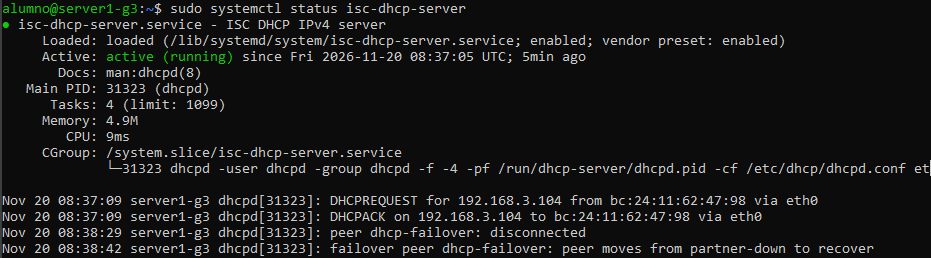

Para comprobar que funciona bien el failover hay que parar el servicio en el server primario y reiniciar la ip en un cliente, si devuelve la misma que tenia, esta bien

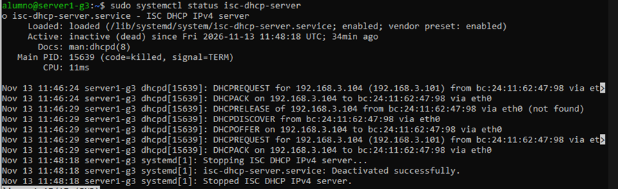

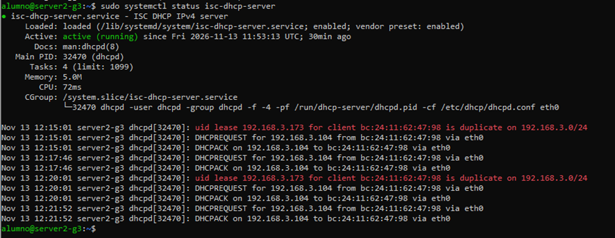

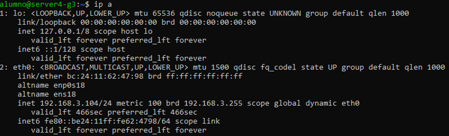

Aun quitando el dhcp del pfsense, funciona:


Teniendo la configuracion de DHCP en el server4 en "true"

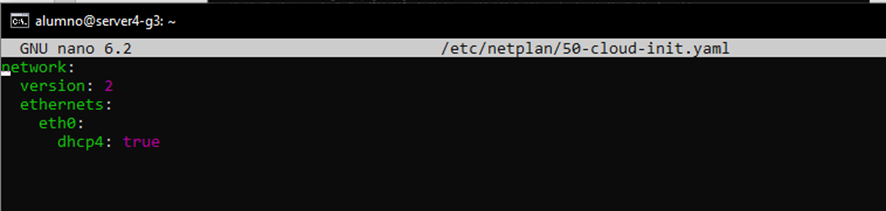

Sigue dando la ip asignada:

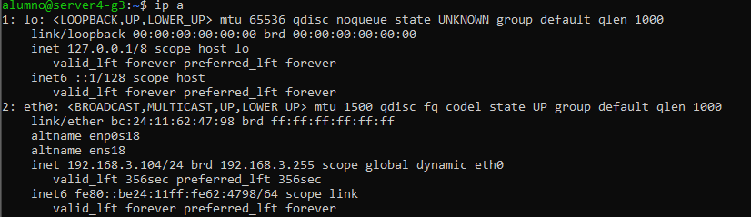

---

## 5. Fase 4: Servidores Web Apache2 y Cifrado SSL/TLS (HTTPS)

### 5.1 Despliegue Web Principal y SSL en `Server 3` (`192.168.3.103`)

1. **Personalización del contenido web:**
   Edición del archivo principal `/var/www/html/index.html` con el contenido corporativo de `www.grupo3reto4.eus`.

   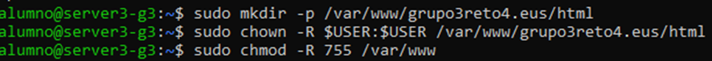

   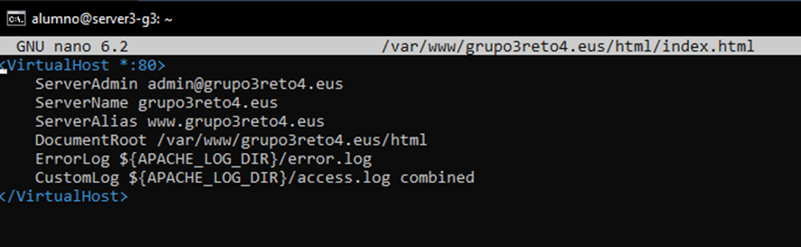

2. **Activar la pagina web**

Crear el archivo de los sitios disponibles

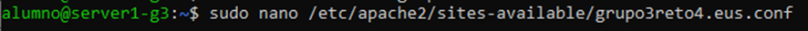

Añadir la configuracion

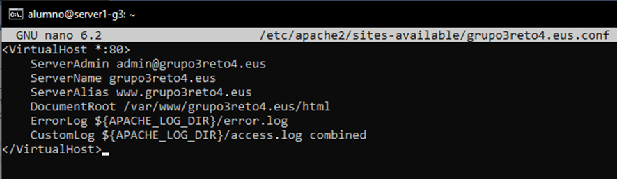

Activar y reiniciar


### 5.2 Configuración SSL (HTTPS) en el Servidor Intranet (`172.16.250.103`)

1. **Activación del módulo SSL y creación del certificado:**

   ```bash
   sudo a2enmod ssl
   sudo a2ensite default-ssl
   sudo openssl req -x509 -nodes -days 365 -newkey rsa:2048 \
     -keyout /etc/ssl/private/intranet.key \
     -out /etc/ssl/certs/intranet.crt \
     -subj "/C=ES/ST=Bizkaia/L=Bilbao/O=Grupo3/CN=intranet.grupo3reto4.eus"
   ```

2. **Configuración del VirtualHost SSL (`/etc/apache2/sites-available/default-ssl.conf`):**

   ```apache
   ServerName intranet.grupo3reto4.eus
   DocumentRoot /var/www/html

   SSLCertificateFile      /etc/ssl/certs/intranet.crt
   SSLCertificateKeyFile   /etc/ssl/private/intranet.key
   ```

   

3. Validación con `sudo apache2ctl configtest`.


4. Comprobacion de las distintas webs


5. Instalar el monitorix


---

## 6. Verificación y Acceso desde Equipo Cliente del Aula

Para resolver los dominios corporativos desde un equipo cliente de la red `172.26.44.0/24` sin modificar el archivo `hosts`:

1. Configurar la interfaz de red del cliente asignando como **Servidor DNS preferido** la IP `172.26.46.53` (pfSense con reenvío NAT al puerto `53` de `192.168.3.101`).
2. Comprobar el acceso a los distintos servicios desplegados:
   * **Web Principal (HTTPS):** `https://www.grupo3reto4.eus` y `https://grupo3reto4.eus` (puerto `443` → `192.168.3.103:443`).
   * **Web Principal (HTTP):** `http://www.grupo3reto4.eus:3880` (puerto `3880` → `192.168.3.103:80`).
   * **Web Intranet (HTTPS):** `https://intranet.grupo3reto4.eus` (`172.16.250.103:443`).
   * **Monitorización (Monitorix):** `http://172.26.46.53:8381/monitorix` (puerto `8381` → `192.168.3.103:8080`).
   * **Administración SSH:**
     * `server1` (`192.168.3.101`): `ssh usuario@172.26.46.53 -p 2231`
     * `server2` (`192.168.3.102`): `ssh usuario@172.26.46.53 -p 2232`
     * `server3` (`192.168.3.103`): `ssh usuario@172.26.46.53 -p 2233`
     * `server4` (`192.168.3.104`): `ssh usuario@172.26.46.53 -p 2234`


